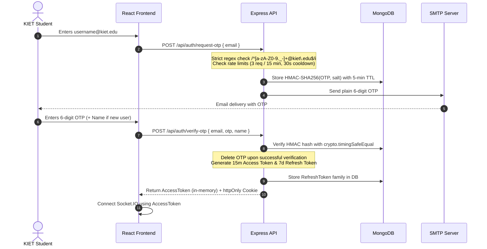

# KIET Lost & Found Backend API

A production-grade backend service powering the **KIET Group of Institutions Lost & Found** campus recovery platform. Built with Express, MongoDB (Mongoose), Socket.IO for real-time inquiries, single-use HMAC-SHA256 hashed OTP authentication, Cloudinary media storage, and privacy-first campus geolocation.

---

## 1. Setup Instructions

### Prerequisites
- **Node.js**: `v18.0.0` or higher (tested on Node 18, 20, 22)
- **npm**: `v9.0.0` or higher
- **MongoDB**: MongoDB 6.0+ instance (Local MongoDB or MongoDB Atlas URI)

### Quick Start
```bash
# 1. Navigate to backend directory
cd backend

# 2. Install dependencies
npm install

# 3. Create local environment file
cp .env.example .env
# Edit .env with your MongoDB URI, JWT secrets, and credentials

# 4. Seed initial campus administrator
node src/scripts/seedAdmin.js admin@kiet.edu "Campus Proctor"

# 5. Run automated test suite
npm test

# 6. Start development server
npm run dev
# Server starts on http://localhost:5001
```

---

## 2. Environment Variables Reference

| Variable | Description | Default / Example | Required |
| :--- | :--- | :--- | :--- |
| `NODE_ENV` | Environment mode (`development`, `test`, `production`) | `development` | Yes |
| `PORT` | HTTP & WebSocket port | `5001` (Port 5000 is reserved by macOS AirPlay) | Yes |
| `MONGODB_URI` | MongoDB connection string (Atlas or local) | `mongodb+srv://...` | Yes |
| `JWT_SECRET` | Secret key for signing 15-minute access JWTs | `random_32_char_hex_secret` | Yes |
| `REFRESH_SECRET` | Secret key for signing 7-day refresh tokens | `random_32_char_hex_secret` | Yes |
| `OTP_SECRET` | Secret key for HMAC-SHA256 hashing OTPs | `random_32_char_hex_secret` | Yes |
| `SMTP_HOST` | Institutional SMTP hostname | `smtp.gmail.com` | Yes |
| `SMTP_PORT` | Institutional SMTP port | `587` | Yes |
| `SMTP_SECURE` | Use TLS directly (`true` for 465, `false` for 587) | `false` | No |
| `SMTP_USER` | Sending email address | `lostandfound@kiet.edu` | Yes |
| `SMTP_PASS` | SMTP 16-character App Password | `xxxx xxxx xxxx xxxx` | Yes |
| `EMAIL_FROM` | Sender display name & address | `"KIET Lost & Found" <noreply@kiet.edu>` | Yes |
| `CLOUDINARY_CLOUD_NAME` | Cloudinary cloud identifier | `kiet-campus` | In Prod |
| `CLOUDINARY_API_KEY` | Cloudinary API Key | `123456789012345` | In Prod |
| `CLOUDINARY_API_SECRET` | Cloudinary API Secret | `secret_hex_token` | In Prod |
| `FRONTEND_URL` | Allowed CORS origin for React/Vite app | `http://localhost:5173` | Yes |
| `DEV_OTP_LOG` | Print OTP to server console (Strictly dev/test only) | `true` (Fails startup in production) | No |

---

## 3. SMTP Institutional Email Configuration Guide

The platform strictly verifies users via `@kiet.edu` emails. To send real OTP verification emails via Google Workspace / Gmail:

1. **Log into KIET Google Account**:
   Open [Google Account Management](https://myaccount.google.com/) for your campus email account (`@kiet.edu`).
2. **Enable 2-Step Verification**:
   Navigate to **Security** → **2-Step Verification** and complete setup.
3. **Generate App Password**:
   - In **Security**, search for **App passwords** (or go to [myaccount.google.com/apppasswords](https://myaccount.google.com/apppasswords)).
   - Under **Select app**, choose **Other (Custom name)** and enter `KIET Lost and Found`.
   - Click **Generate**.
   - Copy the generated 16-character password (e.g. `abcd efgh ijkl mnop`).
4. **Update `.env`**:
   ```env
   SMTP_HOST=smtp.gmail.com
   SMTP_PORT=587
   SMTP_SECURE=false
   SMTP_USER=your.account@kiet.edu
   SMTP_PASS=abcdefghijklmnop
   EMAIL_FROM="KIET Lost & Found" <your.account@kiet.edu>
   ```

---

## 4. Cloudinary Media Storage Setup Guide

1. Sign up for a free tier account at [Cloudinary](https://cloudinary.com/).
2. In your Cloudinary Dashboard, copy your **Cloud Name**, **API Key**, and **API Secret**.
3. Place them into `backend/.env`:
   ```env
   CLOUDINARY_CLOUD_NAME=my-kiet-cloud
   CLOUDINARY_API_KEY=123456789012345
   CLOUDINARY_API_SECRET=abcde12345fghij67890
   ```
4. *Local / Offline Fallback*: If Cloudinary credentials are not provided in development or testing, the service automatically falls back to an embedded data-URI buffer handler with zero crashes.

---

## 5. API Documentation

### Authentication & User Endpoints
| Method | Path | Auth | Rate Limit | Description |
| :--- | :--- | :--- | :--- | :--- |
| `POST` | `/api/auth/request-otp` | Public | 3 / 15m (Email & IP) | Validates `@kiet.edu` email, hashes and dispatches 6-digit OTP |
| `POST` | `/api/auth/verify-otp` | Public | 5 / 15m (IP) | Verifies OTP; returns 15-min access JWT + sets 7-day httpOnly cookie |
| `POST` | `/api/auth/refresh` | Cookie | Normal | Rotates refresh token (token family reuse detection) |
| `POST` | `/api/auth/logout` | Cookie | Normal | Revokes refresh token and clears cookie |
| `GET` | `/api/auth/me` | Bearer | Normal | Fetches authenticated user profile & roles |
| `PATCH` | `/api/auth/profile` | Bearer | Normal | Updates user name or avatar |

### Items & Discovery Endpoints
| Method | Path | Auth | Description |
| :--- | :--- | :--- | :--- |
| `GET` | `/api/items` | Optional | Paginated search & filter items (type, category, location, date, query) |
| `GET` | `/api/items/:id` | Optional | Retrieve item details (coordinates sanitized based on auth) |
| `GET` | `/api/items/:id/location` | Optional | Returns location details, directions URL, and approximation flag |
| `POST` | `/api/items` | Bearer | Multipart upload: create lost/found report with up to 5 photos |
| `PATCH` | `/api/items/:id` | Bearer | Update report (reporter or admin only) |
| `DELETE` | `/api/items/:id` | Bearer | Delete report (reporter or admin only) |
| `POST` | `/api/items/:id/resolve` | Bearer | Mark item as reunited/resolved with timestamp and resolver ID |

### Campus Locations & Directions
| Method | Path | Auth | Description |
| :--- | :--- | :--- | :--- |
| `GET` | `/api/locations/campus` | Public | List static KIET campus landmarks with GPS coordinates |
| `GET` | `/api/locations/directions` | Public | Returns deep-links for Google Maps and OpenStreetMap |

### Reports & Moderation
| Method | Path | Auth | Description |
| :--- | :--- | :--- | :--- |
| `POST` | `/api/reports` | Bearer | Flag listing (`suspicious`, `spam`, `inappropriate`, `fake`, `harassment`) |
| `GET` | `/api/admin/reports` | Admin | List all user-flagged item reports |
| `PATCH` | `/api/admin/reports/:id` | Admin | Update report review status (`reviewed`, `dismissed`) |
| `GET` | `/api/admin/items` | Admin | List all items including archived/suspended |
| `PATCH` | `/api/admin/users/:id/suspend` | Admin | Suspend or unsuspend student account |

### Chat & Inquiries
| Method | Path | Auth | Description |
| :--- | :--- | :--- | :--- |
| `POST` | `/api/conversations` | Bearer | Find or create 1-on-1 inquiry conversation for an item |
| `GET` | `/api/conversations` | Bearer | List conversations current user is participating in |
| `GET` | `/api/conversations/:id` | Bearer | Get conversation details |
| `GET` | `/api/conversations/:id/messages` | Bearer | Paginated message history |
| `POST` | `/api/conversations/:id/messages` | Bearer | Send message via REST API |
| `POST` | `/api/conversations/:id/attachments` | Bearer | Upload image attachment for chat message |
| `PATCH` | `/api/conversations/:id/read` | Bearer | Mark all incoming messages in conversation as read |

---

## 6. Socket.IO Real-Time Events

WebSocket connection authenticates via `socket.handshake.auth.token` (Access JWT).

| Event | Direction | Payload | Description |
| :--- | :--- | :--- | :--- |
| `joinConversation` | Client → Server | `{ conversationId }` | Joins `conversation:<id>` room after DB membership check |
| `sendMessage` | Client → Server | `{ conversationId, text, attachments }` | Sends message (throttled: max 20 msgs / 10 sec) |
| `receiveMessage` | Server → Client | `{ message, conversationId }` | Broadcast to all room members upon new message |
| `typing` | Client → Server | `{ conversationId }` | Emits typing notification to conversation room |
| `stopTyping` | Client → Server | `{ conversationId }` | Clears typing notification |
| `messageRead` | Client → Server | `{ conversationId }` | Marks messages read and emits receipt to sender |
| `userOnline` / `userOffline` | Server → Client | `{ userId }` | Presence updates across campus |

---

## 7. Authentication Flow



---

## 8. Privacy-First Location Design

Campus items often involve sensitive electronics or personal belongings. To prevent stalking, fraudulent claims, or unauthorized pickups:

1. **Unauthenticated Browsing**:
   - Location coordinates for unauthenticated or public viewers are rounded to **3 decimal places** (~110-meter neighborhood radius).
   - Prevents public map scrapers or non-students from discovering precise drop locations.
2. **Authenticated Campus Community**:
   - Signed-in students with verified `@kiet.edu` accounts receive exact GPS coordinates and interactive directions.
3. **Lost vs. Found Items**:
   - For lost items, only the general reported area is displayed to avoid opportunistic scavengers.
   - For found items, coordinates lead students to verified campus buildings or handover points (e.g. Central Library desk).

---

## 9. Admin User Seeding

To bootstrap an administrator account, run the CLI script with the desired `@kiet.edu` email:

```bash
cd backend
node src/scripts/seedAdmin.js admin@kiet.edu "Campus Security Admin"
```

If the user already exists, their role is upgraded to `admin` and `isVerified` is ensured. If the user does not exist, a new verified administrator account is created.
